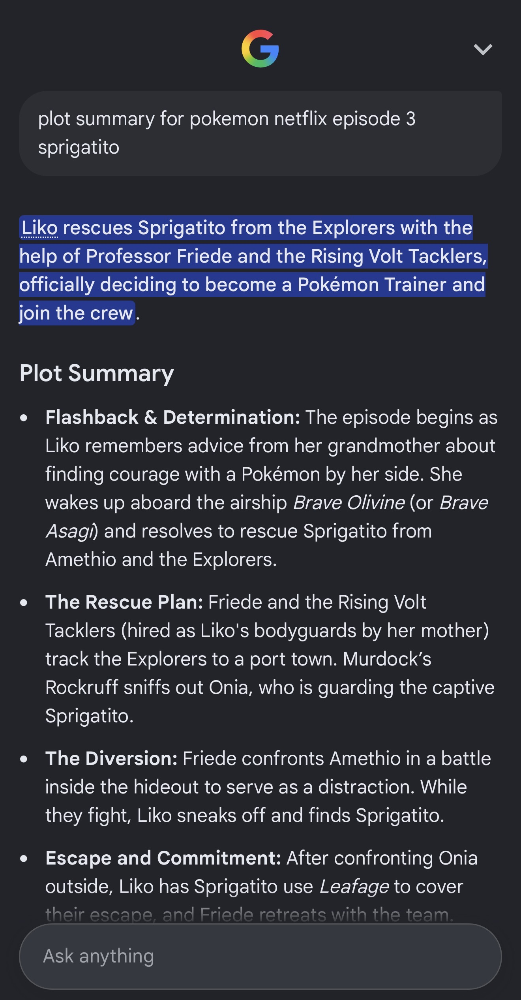

My youngest daughter has neurodiverse challenges that we're still figuring out at the moment. One thing she finds especially hard is media that makes her feel stressed or anxious. She's often found it very hard to separate the fiction of a story from reality, she finds tension and drama extremely uncomfirtable, she finds music that builds tension overwhelming, and she struggles a lot with nightmares.

The place we see this the most is with movies and TV shows. She finds it very hard to watch anything with any kind of mild threat, even down to characters breaking relatively minor rules. She worries so much that she just doesn't enjoy the experience.

One way we've always handled this as a family is by reading lots of stories. As the reader, my wife and I can set the intensity with our voice. We can tweak the language and change how we read things in a way that we know won't overwhelm her. We can spend time talking through the story, embellish it, and add different phrasing and explanations that we know will mean she can enjoy it.

When you read a story you have so much control over it. When you watch a TV show the only thing you can really control is the volume. We do use that. Sometimes we try to flatten out the intense bits by turning it down, or if something gets too loud we just mute it for a little while, especially if there's no dialogue. But the controls in that medium are so limited.

## Knowing her limits

The older she gets, the more aware she is of her own challenges and limitations. She's become very good at self-censoring what she consumes and making decisions to help herself. But often that means choosing not to do something without an equivalent substitute.

Recently both of my daughters have got really into Pokemon, which seems to be the craze that's come back around again. They started watching the newest TV series on Netflix. We got a couple of episodes in and it was relatively intense. There's a lot of action, music and drama. She was really interested, but she was struggling. She was finding it very difficult to watch.

We reached the end of one of the episodes and Sprigatito, one of the main Pokemon in the story, was captured by the enemy team. The episode finished on a cliffhanger.

")

She made the call at that point and said to me "I don't think I can watch any more of this. It's too intense. I think I'm going to have nightmares. Can we watch something else?".

So we turned it over and watched something else. I never want to force her to do something, I want her to listen to her own feelings.

A few weeks went by and she's still very interested in Pokemon. She's started collecting the trading cards and is generally interested in the stories and the franchise, but she'd decided she didn't want to watch the TV show. Then at breakfast one morning she told me she still thinks about that episode. She's worried because it ended on a cliffhanger and she doesn't know how it resolves. She said she doesn't want to watch the next one, she just wants to know that Sprigatito was okay.

When scrolling through the season episodes I had already seen that the thumbnail for a later episode showed those two characters reunited. It's a Netflix show and so it was likely the cliffhanger would resolve within the first few minutes of the next episode, but she doesn't know thats how they work yet.

I showed her the thumbnail and said "look, there they are, they're back together, she must have been rescued", but that wasn't satisfying for her. She wanted to know how the story continues and resolves in detail.

## A short bedtime story

So I pulled out my phone and searched for a plot summary of the episode. Something like "plot for Pokemon netflix episode 3 Sprigatito".

The Google result came back with a bullet point synopsis of the episode. I read through it and described it to her. "They go here, they do this, this happens." I could see she was interested, but it still wasn't quite what she'd imagined. So I started embellishing it a little into more of a story.

Then it struck me. The response was one of the Google AI generated answers at the top of the page, so I thought I'd prompt it like I'd prompt any other model. I added "in the form of a short bedtime story" to the end of my search.

What it generated was about four paragraphs that covered the full plot outline of the episode, but in a way that felt a lot more natural to read to her. So I read the story out from my phone, and she really enjoyed it. I could see the relief on her face as I read it. It was like any other bedtime story and it closed that story loop for her.

When I got to the end she asked for another one. So I looked up the next episode, put in the same prompt, and read her that one too. We did a couple of those while she finished her breakfast.

## AI as a lens

It got me thinking about AI as an interpretive medium. Of course you can put in a small prompt and extrapolate out large amounts of text. But you can also put in large things, distil them down to their core ideas, and output that in different formats.

I don't know what source material Google used for that episode. I assume it was a bunch of blog posts and web pages describing it, or maybe even the subtitles. But through the lens of Google's AI, all of that was distilled down into a short children's bedtime story.

The thing that struck me is that this is exactly what my wife and I do when we read to her. We adapt the story so she can enjoy it. We've just never been able to do that with a TV show before.

I feel like this is an insight into how we may consume all sorts of media in the future. If we take the original media as a reference, having AI transform it into other mediums is going to be a growing way that we consume things.

## Who pays?

The progress being made with these models is astounding. It's hard for anyone to keep up. Even people like me who work on the cutting edge of this stuff are constantly taken by surprise by something another lab builds.

If you look at the Will Smith eating spaghetti videos over the last few years, the advances are incredible. Every 12 months they seem to take a huge leap forwards. If you extrapolate that progress, I can only imagine we're not far away from taking some source material, maybe a chapter of a book, and expanding it into a full 20 minute TV episode that is good enough to actually enjoy watching.

<!-- TODO: GIF/video of the Will Smith eating spaghetti progression over the years -->

In the same way that I can take the synopsis of a TV episode and turn it into a bedtime story to make it more accessible for my daughter, we could go in any number of directions. Take some source material and transform it into whatever medium we prefer. Instead of being consumers of media, we're becoming directors of media. We can consume it however we want.

But this completely breaks the value chain. When I pay my monthly Netflix subscription to watch a Pokemon episode, that money has a clear path back to the people who created it. The writers, the animators, the voice actors. If I go to Google and ask for a kid's bedtime story of an episode plot, there is no value transfer to the creators at all.

In my case my eldest is still watching the show on Netflix, so I don't feel too bad about it. But it does make me wonder. With all new technologies like this, once the genie is out of the bottle there's no putting it back in. As a society we need to adapt and figure out how to fix that broken chain of value.
